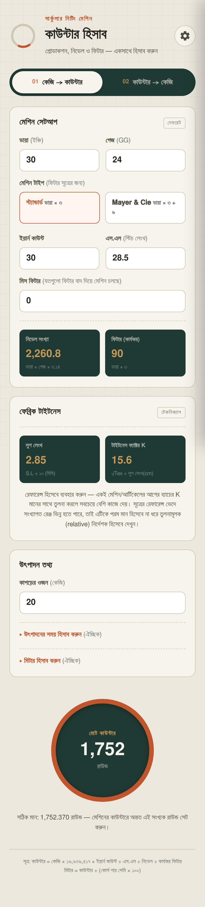
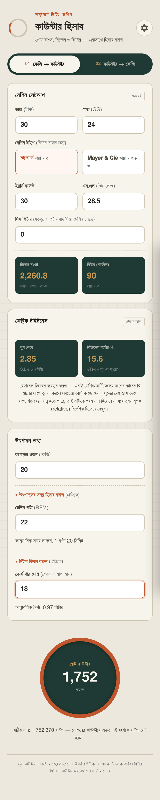
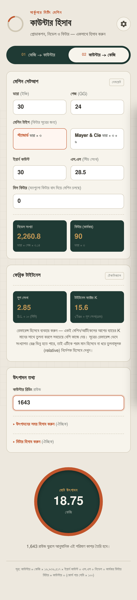
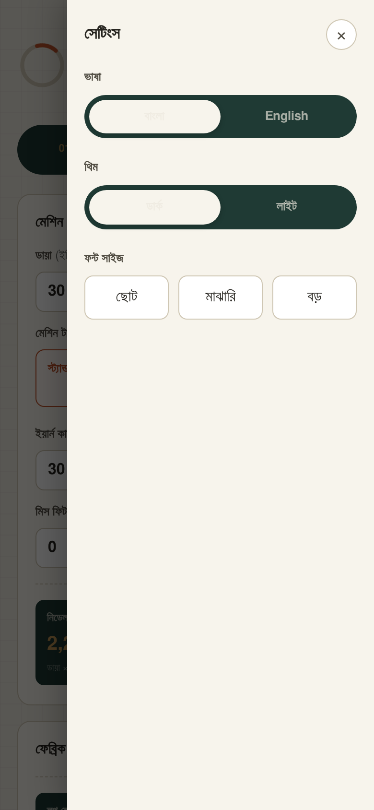

# 🧵 কাউন্টার হিসাব (KPC)

**সার্কুলার নিটিং মেশিনের কাউন্টার হিসাব এখন মোবাইলেই — কয়েক সেকেন্ডে।**

নিটিং অপারেটর ও নিটিং সেকশনের ভাইদের জন্য বানানো একটি সহজ মোবাইল অ্যাপ। মেশিনের তথ্য আর কাপড়ের ওজন লিখলেই অ্যাপ বলে দেবে কাউন্টারে কত রাউন্ড সেট করতে হবে।

> ⚠️ **গুরুত্বপূর্ণ:** এই অ্যাপ দিয়ে শুধু **সিঙ্গেল জার্সি (Single Jersey) ফেব্রিকের** হিসাব বের করা যায়। রিব, ইন্টারলক বা অন্য ফেব্রিকের হিসাব এখানে করবেন না।

---

## 📱 এই অ্যাপ দিয়ে কী কী করা যায়

- ✅ **কেজি থেকে কাউন্টার** — কত কেজি কাপড় বানাবেন তা লিখলে বলে দেবে মেশিনের কাউন্টারে কত রাউন্ড দিতে হবে।
- ✅ **কাউন্টার থেকে কেজি** — কাউন্টারে কত রাউন্ড চলেছে তা লিখলে বলে দেবে কত কেজি কাপড় হয়েছে।
- ✅ **নিডেল সংখ্যা** — মেশিনের মোট নিডেল কতটি, তা নিজে থেকেই দেখায়।
- ✅ **ফিটার সংখ্যা** — চালু ফিটার কতটি, তা নিজে থেকেই দেখায়। কিছু ফিটার বন্ধ রেখে চালালে সেটাও হিসাবে ধরে।
- ✅ **সময় হিসাব (ঐচ্ছিক)** — মেশিনের গতি (RPM) দিলে কত ঘণ্টা-মিনিট লাগবে তা দেখায়।
- ✅ **মিটার হিসাব (ঐচ্ছিক)** — কোর্স পার সেমি দিলে কাপড় কত মিটার হবে তা দেখায়।
- ✅ **বাংলা ও ইংরেজি** — যেকোনো ভাষায় ব্যবহার করা যায়।
- ✅ **ডার্ক ও লাইট থিম, ছোট-বড় লেখা** — নিজের পছন্দমতো সাজিয়ে নিন।

---

## ⬇️ ডাউনলোড ও ইন্সটল করার নিয়ম

### ধাপ ১: অ্যাপ ডাউনলোড করুন

1. মোবাইলের ব্রাউজারে (Chrome) এই লিংকে যান:
   👉 **https://github.com/mohiuddinramzan2/kpc/releases**
2. সবার উপরের (সবচেয়ে নতুন) লেখার নিচে **Assets** এর ভেতরে **`app-debug.apk`** ফাইলটিতে চাপ দিন।
3. ডাউনলোড শেষ হওয়া পর্যন্ত অপেক্ষা করুন।

### ধাপ ২: ইন্সটল করুন

1. ডাউনলোড করা `app-debug.apk` ফাইলটি খুলুন।
2. ফোন যদি বলে **"এই উৎস থেকে ইন্সটল অনুমোদিত নয়"** — তাহলে **সেটিংস** এ চাপ দিয়ে **"এই উৎস থেকে অনুমতি দিন"** চালু করুন, তারপর পেছনে এসে আবার **ইন্সটল** চাপ দিন।
3. যদি **"Play Protect"** সতর্কবার্তা আসে, তাহলে **"তবুও ইন্সটল করুন"** (Install anyway) চাপ দিন।
4. ইন্সটল শেষ হলে **খুলুন** চাপ দিন। এখন থেকে ফোনের স্ক্রিনে **KPC** নামে অ্যাপটি পাবেন।

> 💡 অ্যাপ ইন্সটল করার সময় একবার ইন্টারনেট লাগবে। এরপর থেকে নিয়মিত ব্যবহারের জন্য আলাদা কিছু করতে হয় না।

---

## 📖 ব্যবহারের নিয়ম

### 🔹 ১. অ্যাপ খুললে যা দেখবেন

  

অ্যাপ খুললেই উপরে দুটি বাটন দেখবেন:
- **কেজি → কাউন্টার** — কেজি জানা আছে, কাউন্টার জানতে চান।
- **কাউন্টার → কেজি** — কাউন্টার জানা আছে, কেজি জানতে চান।

যেটা দরকার সেটাতে চাপ দিন।

---

### 🔹 ২. কেজি থেকে কাউন্টার বের করা

  

**মেশিন সেটআপ** অংশে নিজের মেশিনের তথ্য লিখুন:

| ঘরের নাম | কী লিখবেন |
|---|---|
| **ডায়া** | মেশিনের ডায়া (ইঞ্চিতে) |
| **গেজ** | মেশিনের গেজ (GG) |
| **মেশিন টাইপ** | সাধারণ মেশিন হলে **স্ট্যান্ডার্ড**, Mayer & Cie মেশিন হলে **Mayer & Cie** বেছে নিন |
| **ইয়ার্ন কাউন্ট** | যে সুতা চলছে তার কাউন্ট |
| **এস.এল** | স্টিচ লেংথ |
| **মিস ফিটার** | যতগুলো ফিটার বন্ধ রেখে মেশিন চালাচ্ছেন। সব ফিটার চালু থাকলে **0** থাকবে |

তারপর **উৎপাদন তথ্য** অংশে **কাপড়ের ওজন (কেজি)** লিখুন।

নিচের বড় গোল বক্সে **মোট কাউন্টার** দেখা যাবে। 👇

> **উদাহরণ:** ডায়া 30, গেজ 24, ইয়ার্ন কাউন্ট 30, এস.এল 28.5, কাপড় 20 কেজি → কাউন্টার সেট করতে হবে **১,৭৫২ রাউন্ড**।

লেখার নিচে অ্যাপ নিজেই বলে দেয় — *"মেশিনের কাউন্টারে অন্তত এই সংখ্যক রাউন্ড সেট করুন।"*

---

### 🔹 ৩. সময় ও মিটার হিসাব (ঐচ্ছিক)

**⏱ উৎপাদনের সময়:** **"উৎপাদনের সময় হিসাব করুন"** এ চাপ দিয়ে মেশিনের গতি (RPM) লিখুন। অ্যাপ বলে দেবে আনুমানিক কত ঘণ্টা কত মিনিট লাগবে।

**📏 মিটার:** **"মিটার হিসাব করুন"** এ চাপ দিয়ে **কোর্স পার সেমি** লিখুন। অ্যাপ বলে দেবে কাপড় আনুমানিক কত মিটার হবে।

> এই দুটি না লিখলেও কাউন্টার হিসাব ঠিকই কাজ করবে।

---

### 🔹 ৪. কাউন্টার থেকে কেজি বের করা

  

1. উপরে **কাউন্টার → কেজি** বাটনে চাপ দিন।
2. মেশিন সেটআপের তথ্য আগের মতোই দিন।
3. **কাউন্টার রিডিং** ঘরে মেশিনের কাউন্টারে যত রাউন্ড চলেছে তা লিখুন।
4. নিচের গোল বক্সে **মোট উৎপাদন (কেজি)** দেখতে পাবেন।

> **উদাহরণ:** কাউন্টার **1643** রাউন্ড হলে আনুমানিক কাপড় হবে **18.75 কেজি**।

---

### 🔹 ৫. সেটিংস

  

উপরের ডান কোণার **⚙️ গিয়ার** আইকনে চাপ দিলে সেটিংস খুলবে:

- **ভাষা** — বাংলা বা English
- **থিম** — ডার্ক (কালচে) বা লাইট (সাদা)
- **ফন্ট সাইজ** — ছোট, মাঝারি বা বড়

চোখে কম দেখলে **বড়** ফন্ট বেছে নিন।

---

## 💡 কিছু দরকারি কথা

- 📌 এটি **শুধু সিঙ্গেল জার্সি ফেব্রিকের** জন্য।
- 📌 ঘরে নিজের মেশিনের **ঠিক মান** লিখুন, নইলে হিসাব ভুল আসবে।
- 📌 সংখ্যা লিখতে **দশমিক** (যেমন 28.5) ব্যবহার করা যায়।
- 📌 **মিস ফিটার** যদি মোট ফিটারের সমান বা বেশি দেন, অ্যাপ সতর্ক করে দেবে — তখন মানটি ঠিক করুন।
- 📌 অ্যাপের হিসাব **আনুমানিক**। মেশিনে চালানোর আগে নিজের অভিজ্ঞতা ও নিয়ম অনুযায়ী একবার মিলিয়ে নিন।

---

## ❓ সমস্যা হলে

| সমস্যা | সমাধান |
|---|---|
| ইন্সটল হচ্ছে না | ধাপ ২ এর **"এই উৎস থেকে অনুমতি দিন"** চালু করেছেন কিনা দেখুন |
| হিসাব দেখাচ্ছে না | উপরের সব ঘরে সংখ্যা দেওয়া আছে কিনা দেখুন |
| লেখা ছোট লাগছে | সেটিংস থেকে ফন্ট সাইজ **বড়** করুন |

---

**ডেভেলপার:** mohiuddinramzan2
**সোর্স:** https://github.com/mohiuddinramzan2/kpc
